# 랜덤 디펜스 (운빨존많겜 × 원랜디 조합) — UI & 스킬 이펙트 캔버스 아키텍처 v2

> 대상: **Vite + TypeScript + 순수 Canvas 2D** (게임 엔진 없음) · 모바일 세로 화면 · **iPhone/iPad Safari PWA 우선** · GitHub Pages 정적 배포

### v2 변경 요약

| # | 항목 | 변경 |
|---|---|---|
| 1 | 조합 시스템 | 같은 유닛 3개 합성을 없애고 **원랜디식 이종 재료 레시피 DAG**로 교체 (흔함 → 안흔함 → 희귀 → 전설 → 초월 → 불멸). 실시간 인벤토리 인덱싱, 원터치 조합창 알림 램프, 체인 조합, **위습(선택 뽑기)** Command/Snapshot 흐름 추가 → [§7](#7-조합-시스템-원랜디식-레시피-dag) |
| 2 | Safari/PWA 방어 | DPR 상한 2, `100dvh` + `env(safe-area-inset-*)`, `pointer-events` 정책, **정수 틱 고정 시뮬레이션 + 렌더 보간 분리**(1x/2x/3x에서 판정 결과 동일) → [§4](#4-ios-safari--pwa-방어-스펙-필수), [§5](#5-시뮬레이션-루프--고정-틱--렌더-보간-분리) |
| 3 | 빌드/배포 | Vite + TS + Canvas 2D로 고정, **런타임 의존성 0**, GitHub Pages + 홈 화면 추가(PWA) → [§10](#10-빌드--배포-기준-고정) |

---

## 1. 핵심 설계 원칙

| 원칙 | 내용 |
|---|---|
| **기술 스택 고정** | Vite + TypeScript(strict) + Canvas 2D + Vanilla DOM. Phaser/Pixi/Three/React 같은 런타임 라이브러리는 쓰지 않습니다. |
| **캔버스는 '갱신 주기'로 쪼개고, 그리는 순서는 '논리 레이어'로 관리** | 물리 캔버스는 3장만 둡니다. 그리는 순서는 월드 캔버스 안의 렌더 패스로 처리합니다. |
| **시뮬레이션은 정수 틱, 렌더는 보간** | 모든 게임 로직 시간은 `tick`(정수) 단위입니다. 배속은 *틱을 더 자주 돌리는 것*이고, `dt`를 키우지 않습니다. |
| **로직과 연출 분리** | 판정은 `SkillSystem`/`CraftSystem`이 담당하고, 연출은 `VfxSystem`이 담당합니다. VFX는 게임 결과에 영향을 주지 않습니다. |
| **화면 UI는 DOM, 월드에 붙는 UI는 Canvas** | 버튼·패널은 DOM, HP바·데미지 숫자·조합 재료 하이라이트는 캔버스에 그립니다. |
| **UI ↔ 게임은 Command / Snapshot으로만 통신** | UI는 게임 객체를 직접 바꾸지 않습니다. 모든 변경은 다음 틱에 적용되는 Command입니다. |
| **데이터 주도** | 유닛, 등급, 레시피, 스킬, VFX, 웨이브, 위습 풀을 전부 JSON으로 정의하고, 로드할 때 검증합니다. |

---

## 2. 화면 레이아웃 (논리 해상도 720 × 1280, safe-area 안쪽)

```
┌──────────────────────────────────────┐ ← env(safe-area-inset-top) 아래부터
│ [W 23] ⏱ 00:17  👾 47/100 ███░░ ⏸ 1x│  HUD (DOM)                0–100
├──────────────────────────────────────┤
│  ┌────────────────────────────────┐  │
│  │ ← ← ← ← 몬스터 경로 ← ← ← ← ← │  │
│  │ ↓ ┌──┬──┬──┬──┬──┬──┐       ↑ │  │
│  │ ↓ │⚔︎│🏹│  │🔥│  │⚡│       ↑ │  │  필드 (world-canvas)     100–820
│  │ ↓ ├──┼──┼──┼──┼──┼──┤       ↑ │  │  6열 × 3행 = 18칸, 칸당 유닛 1개
│  │ ↓ │  │⚔︎│🛡│  │🏹│  │       ↑ │  │  (설정값: board.json)
│  │ ↓ ├──┼──┼──┼──┼──┼──┤       ↑ │  │
│  │ ↓ │🔥│  │  │⚔︎│  │  │       ↑ │  │
│  │ ↓ └──┴──┴──┴──┴──┴──┘       ↑ │  │
│  │ → → → → → → → → → → → → → ↑ │  │
│  └────────────────────────────────┘  │
├──────────────────────────────────────┤
│ 대기석  [⚔︎][🏹][  ][🔥][  ][  ]      │  대기석 (world-canvas)    820–980
│         [  ][  ][  ][  ][  ][  ]      │  2행 × 6 = 12칸, 공격 안 함
├──────────────────────────────────────┤
│ 🪙 1,240  🍀 37  ✦위습 흔2 안1 희0    │  재화 바 (DOM)
│ ┌─────┐┌─────┐┌─────┐┌──────┐┌─────┐ │
│ │소환 ││도박 ││위습 ││조합 ●3││강화 │ │  하단 액션 (DOM)         980–1280
│ │🪙20 ││🍀1  ││     ││      ││     │ │  ●N = 지금 바로 조합 가능 수
│ └─────┘└─────┘└─────┘└──────┘└─────┘ │
└──────────────────────────────────────┘ ← env(safe-area-inset-bottom) 위까지
```

- **스케일링**: safe-area를 뺀 영역(`#app`의 content box)에 맞춰 `scale = min(w/720, h/1280)`을 구하고, 남는 곳은 레터박스로 칠합니다.
- **대기석**: 필드와 같은 `SlotGrid` 타입입니다(`area: 'bench'`). 드래그로 필드와 오갈 수 있고, 조합 인덱싱 대상에 포함됩니다.
- **협동 모드 확장**: `Board` 인스턴스를 2개 두고 `origin`만 다르게 렌더합니다.

---

## 3. 캔버스 스택 구조

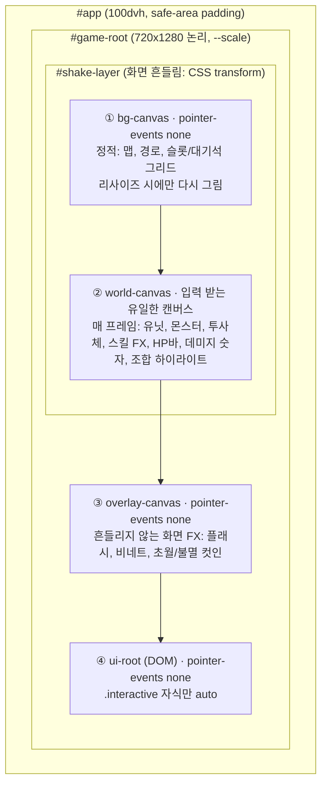

```html
<div id="app">
  <div id="game-root">
    <div id="shake-layer">
      <canvas id="bg-canvas"></canvas>
      <canvas id="world-canvas"></canvas>
    </div>
    <canvas id="overlay-canvas"></canvas>
    <div id="ui-root"><!-- HUD / BottomBar / Panels / Popups (720x1280 논리 px로 작성) --></div>
  </div>
</div>
```

| 캔버스 | 갱신 | context 옵션 | 입력 |
|---|---|---|---|
| bg-canvas | 리사이즈/맵 변경 시 | `{ alpha: false }` | ✗ (`pointer-events:none`) |
| world-canvas | 매 프레임 `clearRect` | `{ alpha: true }` | ✓ 유일 (터치·드래그 → 논리 좌표 변환) |
| overlay-canvas | 활성 연출 있을 때만 | `{ alpha: true }` | ✗ (`pointer-events:none`), 비면 `display:none` |
| ui-root (DOM) | 상태 변경 시 (dirty) | – | 루트는 ✗, `.interactive`만 ✓ |

### 3-1. 해상도 (DPR 상한)

```ts
// render/CanvasStack.ts — 이 공식 외의 방법으로 backing store 크기를 정하지 않음
const QUALITY_DPR_CAP = { high: 2, mid: 1.5, low: 1 } as const;

const renderDpr = Math.min(window.devicePixelRatio || 1, 2, QUALITY_DPR_CAP[quality]); // 절대 2 초과 금지
canvas.width  = Math.round(720  * scale * renderDpr);
canvas.height = Math.round(1280 * scale * renderDpr);
canvas.style.width  = `${720 * scale}px`;
canvas.style.height = `${1280 * scale}px`;
ctx.setTransform(scale * renderDpr, 0, 0, scale * renderDpr, 0, 0); // 이후 모든 그리기는 720x1280 논리 좌표
```

> [!IMPORTANT]
> iPhone Pro/Max 기종은 DPR이 3입니다. 3을 그대로 쓰면 픽셀 수가 2.25배가 되고, 특히 `lighter` 가산 블렌드 파티클에서 발열과 프레임 드랍이 심해집니다. **`Math.min(window.devicePixelRatio, 2)` 상한은 예외 없이 지킵니다.**

### 3-2. world-canvas 내부 논리 렌더 레이어

```ts
export const enum RenderLayer {
  GroundFx   = 0,  // 장판, 범위 원, 데칼, 소환 마법진
  Shadow     = 1,
  Monster    = 2,  // sortY 정렬
  Unit       = 3,  // sortY 정렬 (필드 + 대기석)
  Projectile = 4,
  AirFx      = 5,  // 폭발, 번개, 스파크 ← 'lighter'
  WorldUI    = 6,  // HP바, 상태 아이콘, 데미지 숫자, 드래그 고스트, 조합 재료 하이라이트
}
```

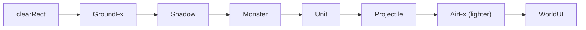

그리는 대상은 모두 `IRenderable { layer; sortY; render(ctx, alpha) }`를 구현합니다. 렌더러는 레이어별로 모아서 그리고, `globalCompositeOperation`은 레이어 단위로 한 번만 바꿉니다.

> [!TIP]
> 화면 흔들림은 `#shake-layer`에 CSS `transform: translate3d()`만 줍니다. 배경과 월드가 같이 흔들리고, UI와 오버레이는 고정됩니다.

---

## 4. iOS Safari / PWA 방어 스펙 (필수)

### 4-1. 체크리스트

| 문제 | 방어 |
|---|---|
| 레티나 발열 / 가산 블렌드 프레임 드랍 | DPR 상한 `Math.min(devicePixelRatio, 2)` + 품질 단계별 추가 상한 ([§3-1](#3-1-해상도-dpr-상한)) |
| 주소창 접힘/펼침으로 높이 변화, 하단 잘림 | `100vh` 폴백 뒤에 `100dvh`. `visualViewport` resize + `ResizeObserver`로 다시 계산 |
| 노치·다이내믹 아일랜드·홈 인디케이터 가림 | `viewport-fit=cover` + `#app`에 `env(safe-area-inset-*)` padding. 논리 화면은 항상 safe-area 안쪽 |
| 오버레이/빈 DOM이 터치를 가로챔 | `#bg-canvas`, `#overlay-canvas`, `#ui-root`는 `pointer-events:none` 강제. 버튼·패널만 `.interactive { pointer-events:auto }` |
| 더블탭 확대 / 핀치 줌 / 고무줄 스크롤 | `touch-action:none`, `overscroll-behavior:none`, `gesturestart` preventDefault (iOS는 `user-scalable=no`를 무시함) |
| 길게 눌러 텍스트 선택 / 콜아웃 / 탭 하이라이트 | `user-select:none`, `-webkit-touch-callout:none`, `-webkit-tap-highlight-color:transparent` |
| 백그라운드 복귀 시 수백 틱 몰아서 실행 | `visibilitychange` hidden → 자동 일시정지 + accumulator 0으로 리셋. 프레임당 최대 틱 수 제한 |
| 오디오 무음 | 첫 `touchend`/`pointerup`에서 `AudioContext.resume()`. 포맷은 AAC(`.m4a`) |
| 캔버스 메모리 한도 초과 (흰 화면/크래시) | 오프스크린 캔버스는 `SpriteCache`가 관리하고, 쓰지 않는 건 `width = height = 0`으로 해제. 거대한 캐시 캔버스 금지 |
| `ctx.filter`, `shadowBlur` | Safari에서 지원·성능이 불안정하므로 **사용 금지**. glow는 프리렌더 스프라이트로 |

### 4-2. 기준 HTML / CSS

```html
<meta name="viewport" content="width=device-width, initial-scale=1, viewport-fit=cover, user-scalable=no">
<meta name="apple-mobile-web-app-capable" content="yes">
<meta name="mobile-web-app-capable" content="yes">
<meta name="apple-mobile-web-app-status-bar-style" content="black-translucent">
<meta name="theme-color" content="#0b0f1a">
<link rel="apple-touch-icon" href="/icons/apple-touch-icon-180.png">
<link rel="manifest" href="/manifest.webmanifest">
```

```css
html, body { margin: 0; height: 100%; overflow: hidden; background: #0b0f1a; overscroll-behavior: none; }

#app {
  position: fixed; inset: 0;
  height: 100vh;               /* 폴백 */
  height: 100dvh;              /* 사파리 주소창 대응 */
  padding: env(safe-area-inset-top) env(safe-area-inset-right)
           env(safe-area-inset-bottom) env(safe-area-inset-left);
  box-sizing: border-box;
  display: grid; place-items: center;
}

#game-root {
  position: relative;
  width: calc(720px * var(--scale)); height: calc(1280px * var(--scale));
  touch-action: none; user-select: none; -webkit-user-select: none;
  -webkit-touch-callout: none; -webkit-tap-highlight-color: transparent;
}
#shake-layer, #game-root canvas { position: absolute; inset: 0; }
#bg-canvas, #overlay-canvas      { pointer-events: none; }

#ui-root {
  position: absolute; left: 0; top: 0; width: 720px; height: 1280px;
  transform: scale(var(--scale)); transform-origin: 0 0;
  pointer-events: none;                       /* 빈 영역은 터치 통과 */
}
#ui-root .interactive { pointer-events: auto; }
```

### 4-3. 리사이즈 파이프라인

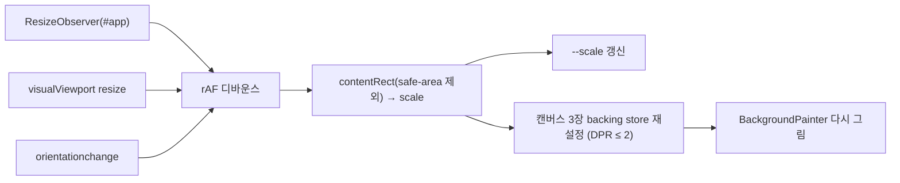

---

## 5. 시뮬레이션 루프 — 고정 틱 + 렌더 보간 분리

### 5-1. 규칙

```ts
export const TICK_HZ = 30;                 // 로직 주파수 (고정)
export const TICK_DT = 1 / TICK_HZ;        // 한 틱의 시뮬레이션 시간 (상수, 절대 스케일 안 함)
export const MAX_TICKS_PER_FRAME = 12;     // 3x + 프레임 드랍 대비 상한
export type Speed = 0 | 1 | 2 | 3;         // 0 = 일시정지
```

1. 게임 로직의 모든 시간(쿨다운, 스턴, `hitDelay`, 웨이브 타이머, 투사체 도착)은 **정수 틱**으로 저장합니다. JSON의 초 단위 값은 로드할 때 `Math.round(sec * TICK_HZ)`로 바꿉니다.
2. **배속 = 실제 1초에 처리하는 틱 수만 늘리는 것**입니다. 1x는 30틱/s, 2x는 60틱/s, 3x는 90틱/s이고, 한 틱의 내용은 똑같습니다.
3. 로직 안에서 `performance.now()`, `Date.now()`, `Math.random()`, 프레임 `dt`를 읽지 않습니다. 난수는 시드 RNG(`core/Rng.ts`)만 쓰고, 틱 안에서만 소비합니다.
4. Command는 큐에 쌓였다가 **다음 틱 시작 시** `tick` 번호를 찍어 적용합니다. 그래서 같은 시드 + 같은 `(tick, command)` 로그를 넣으면 배속과 기기에 상관없이 결과가 같습니다.
5. 렌더러는 상태를 바꾸지 않고 `prev → curr`를 `alpha`로 보간해서 그리기만 합니다.

```ts
// core/GameLoop.ts (의사코드)
frame(now) {
  const realDt = Math.min((now - this.last) / 1000, 0.25); this.last = now;
  this.acc += realDt * this.speed;                         // 시뮬레이션 시간 누적
  let n = 0;
  while (this.acc >= TICK_DT && n < MAX_TICKS_PER_FRAME) {
    this.sim.tick();                                       // commands → systems, tick++
    this.acc -= TICK_DT; n++;
  }
  if (n === MAX_TICKS_PER_FRAME) this.acc = 0;            // 따라잡기 포기 = 느려질 뿐, 결과는 결정적
  const alpha = this.acc / TICK_DT;                        // 0..1
  this.renderer.render(this.sim.state, alpha);             // 보간 렌더 + VFX
  this.ui.sync(this.sim.snapshot());
}
```

### 5-2. 프레임 파이프라인

```mermaid
sequenceDiagram
    participant RAF as requestAnimationFrame
    participant Loop as GameLoop
    participant Sim as Simulation (정수 틱)
    participant VFX as VfxSystem
    participant R as Renderer
    participant UI as UIManager

    RAF->>Loop: frame(now)
    Loop->>Loop: acc += realDt × speed(0/1/2/3)
    loop while acc ≥ TICK_DT (최대 12회)
        Loop->>Sim: tick() — Commands → Wave → Spawn → Move → Combat → Skill → Status → Craft → Economy
        Sim-->>VFX: EventBus (skill:cast @tick, unit:hit, craft:done ...)
    end
    Loop->>R: render(state, alpha)
    R->>VFX: collect(layer, simTime = (tick + alpha) × TICK_DT)
    Loop->>UI: sync — 조합/인벤토리 diff는 즉시, 나머지는 최대 10Hz
```

### 5-3. VFX와 판정 동기화

- 각 VFX 인스턴스는 시작 틱(`startTick`)을 저장하고, 진행 시간은 `t = (currentTick + alpha - startTick) × TICK_DT`로 계산합니다. **프레임 dt를 누적하지 않기** 때문에 3x에서도 번개가 떨어지는 장면과 데미지 판정 틱이 정확히 맞습니다.
- 화면 컷인처럼 배속과 상관없이 실제 시간으로 보여야 하는 트랙만 `timeBase: 'real'`을 지정합니다.
- 투사체는 로직(틱) 객체이고, 도착 틱에 판정합니다. 트레일과 스프라이트는 보간 위치에 그리는 장식일 뿐입니다.

### 5-4. 결정성 테스트 (필수)

`tests/determinism.test.ts`: 같은 시드와 커맨드 로그로 *1x 렌더 루프 시뮬레이션*과 *3x 시뮬레이션*을 각각 N틱 돌린 뒤, `hashState()`(유닛, 몬스터 HP, 재화, 틱)가 같은지 확인합니다.

---

## 6. 게임 UI 구조

### 6-1. UI 컴포넌트 트리

```mermaid
flowchart TB
    UIRoot --> HUD
    UIRoot --> BottomBar
    UIRoot --> PanelLayer
    UIRoot --> PopupLayer
    UIRoot --> ToastLayer

    HUD --> WaveIndicator
    HUD --> WaveTimer
    HUD --> MonsterGauge["MonsterGauge (47/100, 80% 이상 경고 점멸)"]
    HUD --> BossBanner
    HUD --> SpeedToggle["SpeedToggle (1x → 2x → 3x)"]
    HUD --> PauseButton

    BottomBar --> CurrencyBar["CurrencyBar (코인 / 행운석 / 등급별 위습)"]
    BottomBar --> SummonButton
    BottomBar --> GambleButton
    BottomBar --> WispButton["WispButton (보유 위습 수 배지)"]
    BottomBar --> CraftButton["CraftButton (READY 수 배지 + 램프 점등)"]
    BottomBar --> UpgradeButton

    PanelLayer --> UnitInfoPanel["UnitInfoPanel (스탯 / 판매 / 잠금 / '이 유닛이 쓰이는 레시피')"]
    PanelLayer --> CraftPanel["CraftPanel (원터치 조합창)"]
    PanelLayer --> WispPicker["WispPicker (등급 탭 + 추천 배지)"]
    PanelLayer --> UpgradePanel
    PanelLayer --> GamblePanel

    CraftPanel --> GradeTabs["GradeTabs (안흔함 / 희귀 / 전설 / 초월 / 불멸, 탭별 램프)"]
    CraftPanel --> RecipeCard["RecipeCard × N (램프 · 재료 보유 n/m · 조합 버튼)"]
    CraftPanel --> RecipeTree["RecipeTree (길게 누르면 하위 재료 트리 펼침)"]

    PopupLayer --> PauseMenu
    PopupLayer --> ResultModal
    ToastLayer --> Toast["'전설 조합 가능!' / '초월 등장!'"]
```

### 6-2. 캔버스에 그리는 UI vs DOM UI

| 캔버스 (WorldUI 레이어) | DOM |
|---|---|
| 몬스터/보스 HP바, 상태 아이콘 | HUD 전체 |
| 데미지 숫자 | 하단 버튼, 재화, 배지 |
| 슬롯 선택 테두리, 사거리 원 | CraftPanel, WispPicker, 강화/도박 패널 |
| 드래그 고스트, 드롭 가능 칸 표시 (필드↔대기석) | 팝업, 토스트 |
| **조합 재료 하이라이트**: RecipeCard를 누르고 있으면 쓰일 유닛에 테두리 표시 | |
| 유닛 등급 테두리 색, 잠금 아이콘 | |

### 6-3. UI ↔ 게임 데이터 흐름

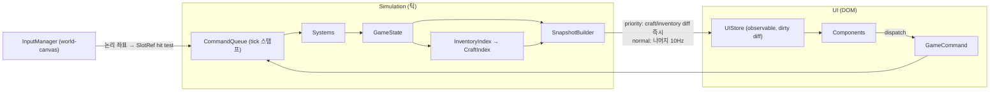

```ts
type SlotRef = { area: 'field' | 'bench'; index: number };

type GameCommand =
  | { type: 'summon' }
  | { type: 'gamble'; tier: GradeId }
  | { type: 'upgrade'; group: UpgradeGroupId }
  | { type: 'move'; from: SlotRef; to: SlotRef }            // 드래그&드롭 (빈칸 이동 또는 스왑)
  | { type: 'sell'; uid: number }
  | { type: 'lock'; uid: number; locked: boolean }          // 조합 재료로 쓰이지 않게 보호
  | { type: 'craft'; recipeId: string; chain: boolean }     // chain=true: 중간 재료까지 자동 조합
  | { type: 'useWisp'; grade: GradeId; unitId: string };    // 위습 선택 뽑기

interface UISnapshot {
  tick: number; speed: Speed;
  wave: number; waveTicksLeft: number;
  monsterCount: number; monsterCap: number;                 // 100 도달 시 패배
  coin: number; luckStone: number; summonCost: number;
  wisps: Partial<Record<GradeId, number>>;
  upgradeLv: Record<UpgradeGroupId, number>;
  field: SlotView[]; bench: SlotView[];                     // { uid, unitId, grade, locked } | null
  craft: CraftView;                                         // §7-5
  wispHints: Partial<Record<GradeId, WispHint[]>>;          // §7-6
  boss?: { hp: number; maxHp: number; ticksLeft: number };
  rejects: { cmd: GameCommand['type']; reason: string }[];  // 실패 사유 → 토스트
}
```

### 6-4. 게임 상태 머신

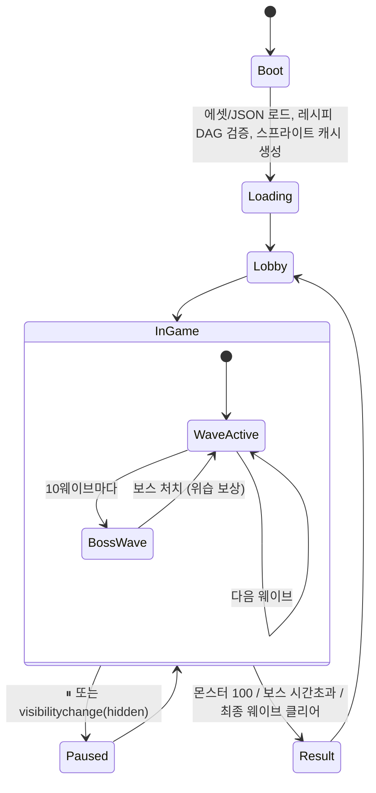

---

## 7. 조합 시스템 (원랜디식 레시피 DAG)

### 7-1. 등급 (데이터 정의)

```json
// data/grades.json — 순서·색·이름은 데이터로만 관리
[
  { "id": "common",       "name": "흔함",   "rank": 1, "color": "#cfd6e0", "summonable": true  },
  { "id": "uncommon",     "name": "안흔함", "rank": 2, "color": "#5ee07a", "summonable": true  },
  { "id": "rare",         "name": "희귀",   "rank": 3, "color": "#4aa8ff", "summonable": false },
  { "id": "legendary",    "name": "전설",   "rank": 4, "color": "#ffb02e", "summonable": false },
  { "id": "transcendent", "name": "초월",   "rank": 5, "color": "#ff4d6d", "summonable": false },
  { "id": "immortal",     "name": "불멸",   "rank": 6, "color": "#f5d76e", "summonable": false, "fx": "rainbow" }
]
```

### 7-2. 레시피 그래프

- **노드** = 유닛(`UnitDef`), **간선** = 레시피(재료 → 결과). 재료는 **서로 다른 유닛 여러 종**이고, 종류마다 필요 개수가 있습니다.
- 한 유닛이 여러 레시피의 재료가 될 수 있고, 한 결과물에 레시피가 여러 개 있을 수도 있습니다(`priority`로 순서 결정).
- **리프(leaf)** = 소환·위습·도박으로만 얻는 유닛(주로 흔함/안흔함).

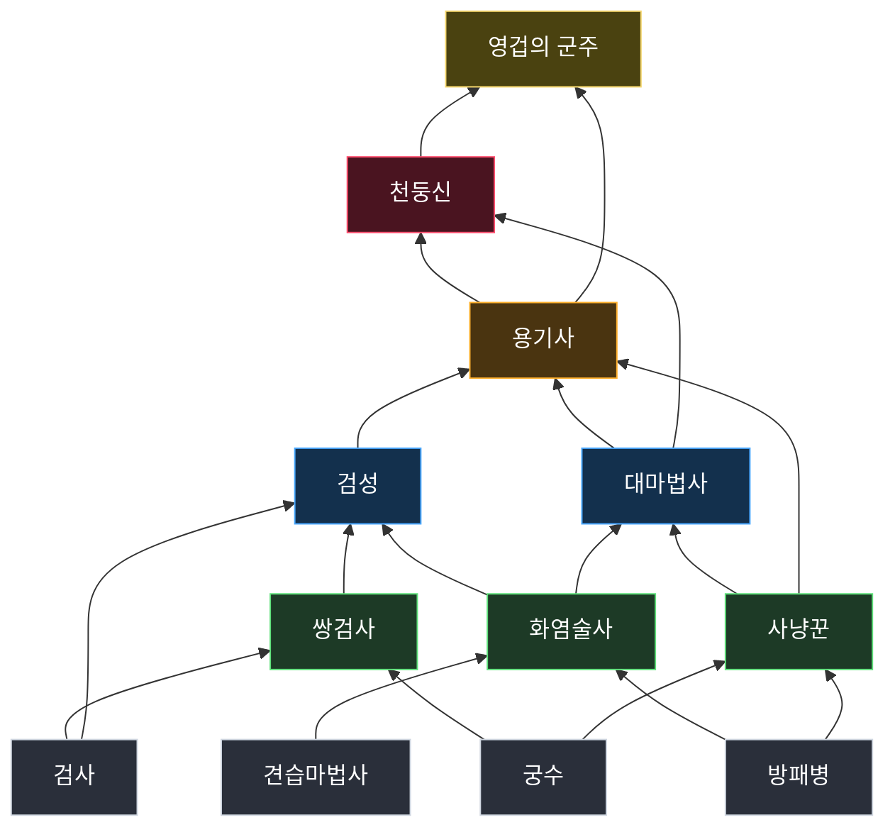

```json
// data/recipes.json
{
  "id": "r_sword_saint",
  "output": "sword_saint",            // 희귀
  "ingredients": [
    { "unit": "dual_blade", "n": 1 }, // 안흔함
    { "unit": "pyromancer", "n": 1 }, // 안흔함
    { "unit": "swordsman",  "n": 2 }  // 흔함
  ],
  "priority": 10
}
```

### 7-3. 로드 시 검증 (실패하면 게임 시작/테스트 실패)

| 규칙 | 내용 |
|---|---|
| R1 참조 무결성 | 모든 `output`/`unit` id가 `units.json`에 있어야 함 |
| R2 등급 단조성 | **모든 재료의 rank < 결과의 rank**. 이 규칙 하나로 사이클이 생길 수 없음 |
| R3 사이클 검사 | Kahn 위상정렬로 한 번 더 확인 (데이터 오류 방어) |
| R4 도달성 | 비리프 유닛은 레시피가 1개 이상 있고, 리프까지 전개할 수 있어야 함 |
| R5 중복 | 같은 결과에 재료 구성까지 같은 레시피 금지 |

### 7-4. 로드 시 사전 계산 (`RecipeGraph`)

```ts
class RecipeGraph {
  readonly byOutput:     Map<UnitId, Recipe[]>;          // 결과 → 레시피들 (priority 순)
  readonly byIngredient: Map<UnitId, Recipe[]>;          // 역인덱스: 재료 → 이 재료를 쓰는 레시피
  readonly closure:      Map<RecipeId, Set<UnitId>>;     // 하위 전개 시 등장하는 모든 유닛 (체인 조합 무효화용)
  readonly byClosure:    Map<UnitId, RecipeId[]>;        // 역: 유닛 → closure에 이 유닛이 있는 레시피
  readonly leafCost:     Map<RecipeId, Map<UnitId, number>>; // 리프까지 펼친 총 재료 (UI 트리 표시)
  readonly topo:         RecipeId[];                     // 위상 순서
}
```

### 7-5. 실시간 인덱싱 → 알림 램프

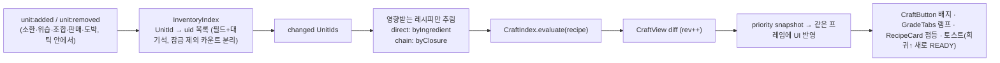

- **전체 재평가 금지**: 인벤토리가 바뀌면 바뀐 `UnitId`에 연결된 레시피만 다시 계산합니다. 보유 유닛이 약 30개, 레시피가 수백 개여도 틱당 비용이 아주 작습니다.
- 잠금(`locked`) 유닛은 재료 개수에서 뺍니다.

```ts
type LampState = 'ready' | 'chainReady' | 'partial' | 'none';
//  ready      : 지금 재료가 모두 있음            → 밝은 램프 + 배지 카운트
//  chainReady : 중간 재료를 먼저 조합하면 가능   → 다른 색 램프 (원터치 체인 조합)
//  partial    : 일부 보유 (진행도 표시)          → 흐린 램프
//  none       : 재료 없음

interface CraftView {
  rev: number;
  readyCount: number;
  byGrade: Partial<Record<GradeId, { ready: number; chainReady: number }>>;
  recipes: Record<RecipeId, {
    lamp: LampState;
    have: number; need: number;                  // 직접 재료 기준 진행도
    missing: { unit: UnitId; n: number }[];
    chainSteps?: RecipeId[];                     // chainReady일 때 실행 순서
  }>;                                            // diff 전송: 바뀐 레시피만
}
```

**체인 조합 플래너 (`CraftPlanner`)**: 가상 인벤토리 복사본 위에서 깊이 우선으로 부족한 재료를 하위 레시피로 메웁니다. 최대 깊이 3, 탐색 예산 제한, 재료 예약(reserve) 방식이라 같은 유닛을 두 번 쓰지 않습니다. 결과는 `byClosure` 기준으로 캐시하고 무효화합니다.

### 7-6. 원터치 조합 실행 흐름

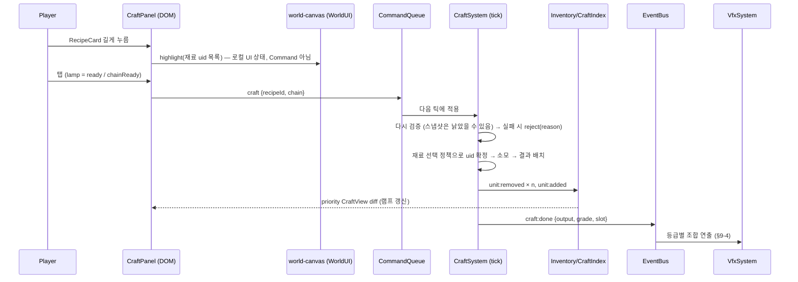

**재료 선택 정책** (같은 유닛이 여러 개일 때): ① 잠금 제외 ② 대기석 우선 ③ 필드에서는 뒤쪽 칸부터.
**결과 배치**: 소모된 필드 칸 중 첫 칸 → 없으면 빈 필드 칸 → 대기석. 재료가 최소 1개 이상 소모되므로 배치할 칸은 항상 생깁니다.
**체인 조합**은 `chainSteps`를 같은 틱 안에서 원자적으로 실행합니다. 중간에 실패하면 전체를 롤백하고 reject합니다.

### 7-7. 위습 (선택 뽑기)

위습 = 등급별 토큰입니다(예: 흔함/안흔함/희귀 위습). 보스 처치, 미션 보상, 판매 등으로 얻고, **해당 등급 풀에서 원하는 유닛을 직접 고릅니다**. 난수를 쓰지 않습니다.

```ts
interface WispHint {
  unitId: UnitId;
  completes?: RecipeId;   // 이 유닛을 고르면 즉시 READY가 되는 레시피 → '완성!' 배지
  gain: number;           // 레시피 진행도 증가량 최댓값 (정렬 기준)
}
```

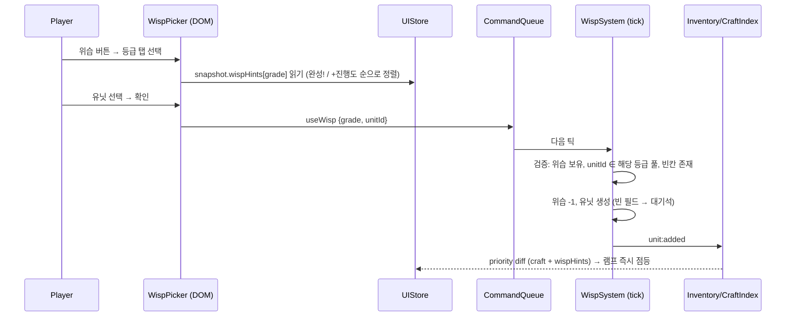

- `wispHints`는 위습을 1개 이상 가지고 있을 때만, 인벤토리가 바뀐 틱에만 다시 계산합니다.

---

## 8. 스킬 시스템 (로직, 틱 기반)

### 8-1. 데이터

```ts
interface SkillDef {               // JSON은 초 단위 → 로드 시 *Ticks로 변환
  id: string;
  trigger: TriggerDef;
  targeting: TargetingDef;
  effects: EffectDef[];
  hitDelay: number;                // → hitDelayTicks
  vfx: string;
  cooldown?: number;               // → cooldownTicks
}

type TriggerDef =
  | { type: 'onAttack'; chance: number }          // 시드 RNG
  | { type: 'everyNAttacks'; n: number }
  | { type: 'mana'; max: number; perHit: number }
  | { type: 'interval'; sec: number }
  | { type: 'aura' };

type TargetingDef =
  | { type: 'single' }
  | { type: 'splash'; radius: number }
  | { type: 'chain'; count: number; range: number; falloff: number }
  | { type: 'line'; width: number; length: number }
  | { type: 'allInRange' }
  | { type: 'global' };

type EffectDef =
  | { type: 'damage'; atkRatio: number; dmgType: 'physical' | 'magic' }
  | { type: 'stun'; duration: number }
  | { type: 'slow'; pct: number; duration: number }
  | { type: 'defShred'; amount: number; duration: number }
  | { type: 'buffAlly'; stat: 'atkSpd' | 'atk'; pct: number; radius: number };
```

- 타깃이 여러 명일 때는 순서를 고정합니다(경로 진행도 내림차순, 같으면 `entityId` 오름차순). 그래야 결정성이 깨지지 않습니다.
- 대기석 유닛은 공격과 스킬을 쓰지 않습니다(오라 포함).

### 8-2. 처리 흐름

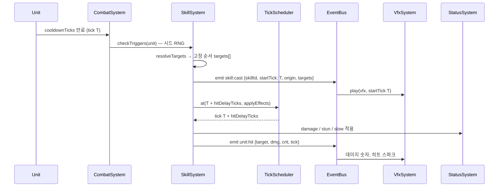

> [!IMPORTANT]
> 판정 시점은 `T + hitDelayTicks` 하나로만 정해집니다. VFX는 같은 `startTick`을 받아 시뮬레이션 시간으로 재생되므로, 1x/2x/3x 어느 배속에서도 연출과 판정이 어긋나지 않습니다. 저사양 모드에서 VFX를 꺼도 결과는 같습니다.

---

## 9. 스킬 이펙트 (VFX) 시스템

### 9-1. 구조: VfxDef = 시간축 위의 Track 묶음

```ts
interface VfxDef { id: string; duration: number; tracks: TrackDef[] }

type TrackDef = {
  delay: number;
  layer: RenderLayer | 'screen';
  anchor: 'origin' | 'target' | 'eachTarget' | 'screen';
  timeBase?: 'sim' | 'real';        // 기본 sim. 컷인 등만 real
} & (
  | { kind: 'sprite';     sheet: string; fps: number; scale?: number; blend?: Blend }
  | { kind: 'particle';   emitter: EmitterDef }
  | { kind: 'beam';       style: 'lightning' | 'laser'; width: number; color: string; jitter?: number }
  | { kind: 'ring';       from: number; to: number; duration: number; color: string; lineWidth: number }
  | { kind: 'decal';      image: string; duration: number; fadeOut: number }
  | { kind: 'projectile'; sprite: string; trail?: EmitterDef; arc?: number }  // 경로/도착은 로직이 결정
  | { kind: 'shake';      intensity: number; duration: number }
  | { kind: 'flash';      color: string; alpha: number; duration: number }
  | { kind: 'cutin';      portrait: string; text: string; duration: number }
  | { kind: 'sound';      id: string }
);
```

```json
{
  "id": "thunder_god_ult",
  "duration": 1.4,
  "tracks": [
    { "delay": 0.0,  "kind": "decal",    "layer": 0, "anchor": "target", "image": "magic_circle", "duration": 1.2, "fadeOut": 0.3 },
    { "delay": 0.0,  "kind": "cutin",    "layer": "screen", "anchor": "screen", "timeBase": "real", "portrait": "thunder_god", "text": "천둥의 심판", "duration": 0.6 },
    { "delay": 0.4,  "kind": "beam",     "layer": 5, "anchor": "eachTarget", "style": "lightning", "width": 6, "color": "#9be7ff", "jitter": 14 },
    { "delay": 0.4,  "kind": "ring",     "layer": 0, "anchor": "eachTarget", "from": 10, "to": 120, "duration": 0.35, "color": "#c9f4ff", "lineWidth": 8 },
    { "delay": 0.4,  "kind": "particle", "layer": 5, "anchor": "eachTarget", "emitter": { "preset": "spark_burst", "count": 24 } },
    { "delay": 0.4,  "kind": "shake",    "layer": "screen", "anchor": "screen", "intensity": 8, "duration": 0.25 },
    { "delay": 0.4,  "kind": "flash",    "layer": "screen", "anchor": "screen", "color": "#ffffff", "alpha": 0.35, "duration": 0.12 }
  ]
}
```
> 이 스킬의 `hitDelay`도 0.4초(=12틱)입니다. 임팩트 트랙의 `delay`와 `hitDelay`가 같은지는 데이터 검증 단계에서 경고로 확인합니다.

### 9-2. 클래스 다이어그램

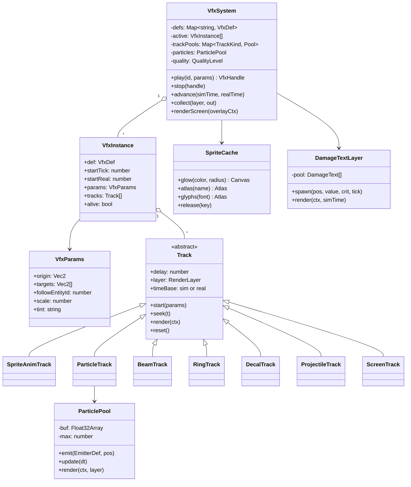

> 트랙은 `update(dt)` 누적 대신 **`seek(t)` 방식**(진행 시간을 넣으면 그 시점 모습을 계산)을 기본으로 합니다. 파티클처럼 누적이 꼭 필요한 것만 `ParticlePool.update(dt)`를 쓰고, 이 경우 `dt`는 시뮬레이션 시간의 차이입니다.

### 9-3. 이펙트 종류별 렌더 기법

| 이펙트 | 레이어 | 기법 |
|---|---|---|
| 소환/조합 마법진, 장판 | GroundFx | 데칼 + alpha 페이드, 회전 |
| 화살/마법탄 | Projectile | 보간 위치에 스프라이트 + 트레일 |
| 폭발, 히트 스파크 | AirFx | 스프라이트시트 + 파티클 버스트, `lighter` |
| 체인 번개 | AirFx | midpoint displacement 지그재그, glow(프리렌더) + core 2패스, 2~3틱마다 시드 기반으로 다시 생성 |
| 충격파 | GroundFx | `arc` 반지름 보간 + `lineWidth`/alpha 감소 |
| 데미지 숫자 | WorldUI | 글리프 아틀라스(`fillText` 반복 금지), 같은 대상 100ms 안의 데미지는 합침 |
| 플래시/컷인 | overlay-canvas | `fillRect` / 초상화 슬라이드 |
| 화면 흔들림 | CSS | `#shake-layer` transform |

### 9-4. 등급별 연출 강도

| 등급 | 획득(소환·조합·위습) 연출 | 공격 연출 |
|---|---|---|
| 흔함 / 안흔함 | 작은 파티클 | 기본 히트 스파크 |
| 희귀 | 파란 링 + 파티클 | 스킬 발동 시 소형 FX |
| 전설 | 금색 기둥 + 토스트 | 범위 FX + 약한 흔들림 |
| 초월 | 컷인 + 플래시 + 흔들림 | 궁극기 컷인, 화면 단위 연출 |
| 불멸 | 무지개 기둥 + 풀스크린 컷인 + 긴 흔들림 | 전용 VFX, 화면 색조 변화 |

---

## 10. 빌드 & 배포 기준 (고정)

### 10-1. 스택

| 항목 | 결정 |
|---|---|
| 번들러 | **Vite** |
| 언어 | **TypeScript** (`strict: true`, `noUncheckedIndexedAccess: true`) |
| 렌더 | **Canvas 2D API만** 사용 (WebGL/게임 엔진 없음) |
| UI | Vanilla DOM + CSS (프레임워크 없음) |
| 런타임 의존성 | **0개** (`dependencies` 비움) |
| 개발 의존성 | `vite`, `typescript`, `vite-plugin-pwa`(서비스워커 생성), `vitest`(결정성/DAG 테스트) |
| 배포 | **GitHub Pages** (GitHub Actions) |
| 설치 | PWA 홈 화면 추가 (iOS Safari "홈 화면에 추가", Android 설치) |

### 10-2. package.json 스크립트

```json
{
  "scripts": {
    "dev": "vite --host",
    "typecheck": "tsc --noEmit",
    "test": "vitest run",
    "validate:data": "vitest run tests/data",
    "build": "tsc --noEmit && vitest run && vite build",
    "preview": "vite preview --host"
  }
}
```

### 10-3. vite.config.ts 기준

```ts
import { defineConfig } from 'vite';
import { VitePWA } from 'vite-plugin-pwa';

export default defineConfig({
  base: process.env.BASE_PATH ?? '/',          // Pages: '/<repo>/' (워크플로에서 주입)
  build: { target: 'es2020', assetsInlineLimit: 0, sourcemap: false },
  plugins: [
    VitePWA({
      registerType: 'autoUpdate',
      includeAssets: ['icons/*.png', 'assets/**/*'],
      manifest: {
        name: 'Random Defense', short_name: 'RDefense',
        start_url: '.', scope: '.', display: 'standalone', orientation: 'portrait',
        background_color: '#0b0f1a', theme_color: '#0b0f1a',
        icons: [
          { src: 'icons/icon-192.png', sizes: '192x192', type: 'image/png' },
          { src: 'icons/icon-512.png', sizes: '512x512', type: 'image/png' },
          { src: 'icons/icon-512-maskable.png', sizes: '512x512', type: 'image/png', purpose: 'maskable' }
        ]
      },
      workbox: { globPatterns: ['**/*.{js,css,html,png,webp,json,m4a}'] }
    })
  ]
});
```

### 10-4. GitHub Pages 배포 흐름

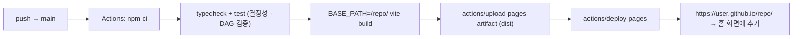

- 단일 `index.html`이고 라우터가 없으므로 404 폴백 처리가 필요 없습니다.
- 모든 에셋 경로는 `import.meta.env.BASE_URL` 기준입니다. 절대 경로 `/assets/...`를 하드코딩하지 않습니다.
- iOS는 manifest 일부를 무시하므로 `apple-touch-icon`(180×180)과 `apple-mobile-web-app-*` 메타 태그를 꼭 같이 넣습니다.
- 에셋은 WebP 아틀라스와 AAC(`.m4a`)를 씁니다. 첫 로드 용량은 15MB 이하를 목표로 합니다(서비스워커 캐시 부담 감소).

---

## 11. 폴더 구조

```
/ (repo root)
├─ AGENTS.md                       # 코딩 에이전트 필수 규칙
├─ docs/ARCHITECTURE.md            # 본 문서
├─ index.html                      # 메타 태그 (§4-2)
├─ vite.config.ts  tsconfig.json  package.json
├─ .github/workflows/deploy.yml
├─ public/
│  ├─ icons/  (apple-touch-icon-180, icon-192, icon-512, maskable)
│  └─ assets/ (atlas *.webp + *.json, sfx *.m4a)
├─ src/
│  ├─ main.ts
│  ├─ styles/app.css               # §4-2 CSS
│  ├─ core/
│  │  ├─ Game.ts                   # 시스템 조립, 상태 머신
│  │  ├─ GameLoop.ts               # 고정 틱 + 보간 (§5)
│  │  ├─ Simulation.ts             # tick(), hashState()
│  │  ├─ time.ts                   # TICK_HZ, secToTicks
│  │  ├─ CommandQueue.ts  EventBus.ts  TickScheduler.ts  Pool.ts  Rng.ts
│  ├─ platform/
│  │  ├─ Viewport.ts               # dvh/safe-area/visualViewport/ResizeObserver → scale
│  │  ├─ Lifecycle.ts              # visibilitychange 자동 일시정지
│  │  └─ AudioUnlock.ts
│  ├─ render/
│  │  ├─ CanvasStack.ts            # 캔버스 3장, DPR ≤ 2
│  │  ├─ Renderer.ts  RenderLayer.ts  BackgroundPainter.ts  SpriteCache.ts  AssetLoader.ts
│  ├─ world/
│  │  ├─ Board.ts  SlotGrid.ts (field/bench)  Path.ts
│  │  ├─ entities/  Unit.ts  Monster.ts  Projectile.ts
│  │  └─ systems/   WaveSystem.ts  SpawnSystem.ts  MovementSystem.ts  CombatSystem.ts
│  │                StatusSystem.ts  EconomySystem.ts  SummonSystem.ts
│  ├─ craft/
│  │  ├─ RecipeGraph.ts            # 로드, 검증 R1~R5, 사전 계산
│  │  ├─ InventoryIndex.ts         # 필드+대기석 실시간 인덱스
│  │  ├─ CraftIndex.ts             # 델타 기반 램프 상태
│  │  ├─ CraftPlanner.ts           # 체인 조합 계획
│  │  ├─ CraftSystem.ts            # craft 커맨드 실행
│  │  └─ WispSystem.ts             # useWisp 커맨드 + wispHints
│  ├─ skills/
│  │  ├─ SkillSystem.ts
│  │  ├─ triggers/  targeting/  effects/
│  ├─ vfx/
│  │  ├─ VfxSystem.ts  VfxInstance.ts  ParticlePool.ts  DamageTextLayer.ts  ScreenFx.ts
│  │  └─ tracks/    SpriteAnimTrack.ts  ParticleTrack.ts  BeamTrack.ts  RingTrack.ts
│  │                DecalTrack.ts  ProjectileTrack.ts  ScreenTrack.ts
│  ├─ ui/
│  │  ├─ UIManager.ts  UIStore.ts
│  │  ├─ hud/  bottom/  popups/
│  │  └─ panels/ UnitInfoPanel.ts  CraftPanel.ts  RecipeCard.ts  WispPicker.ts  UpgradePanel.ts  GamblePanel.ts
│  ├─ input/  InputManager.ts  DragController.ts
│  └─ data/   grades.json  units.json  recipes.json  skills.json  vfx.json  waves.json
│             wisp_pools.json  board.json  gamble_rates.json
└─ tests/
   ├─ determinism.test.ts          # 1x vs 3x 상태 해시 일치
   ├─ data/recipeGraph.test.ts     # R1~R5
   ├─ craftIndex.test.ts           # 델타 인덱싱 = 전체 재계산 결과
   └─ craftPlanner.test.ts
```

---

## 12. 성능 가이드 (iOS 기준)

> [!WARNING]
> `shadowBlur`, `ctx.filter`, 매 프레임 `fillText`, 파티클마다 `save()/restore()`는 금지입니다. glow는 `SpriteCache.glow()` 프리렌더 + `lighter`로 처리합니다.

- **DPR ≤ 2**, 품질 단계(high 2 / mid 1.5 / low 1). 프레임 시간이 계속 20ms를 넘으면 자동으로 한 단계 내립니다.
- **풀링**: 몬스터, 투사체, 트랙, 데미지 텍스트 전부 풀에서 꺼냅니다. 파티클은 `Float32Array` SoA를 씁니다.
- **예산**: 파티클 1,500개, VFX 인스턴스 64개. 3x에서는 장식 파티클 생성량을 `1/speed`로 줄입니다(판정과 무관).
- **조합 인덱싱**은 델타 기반으로만 합니다. 전체 재계산은 테스트에서 정답 비교용으로만 씁니다.
- **DOM 갱신**은 바뀐 값만 `textContent`로 바꾸고, 애니메이션은 `transform`/`opacity`로만 합니다.
- **정적 요소**(경로, 슬롯/대기석 그리드)는 bg-canvas에 한 번만 그립니다.

---

## 13. 구현 순서

1. Vite + TS 뼈대, `Viewport`/`CanvasStack`(DPR ≤ 2, dvh, safe-area), Pages 배포 워크플로 + PWA → **실기기 iPhone에서 홈 화면 추가 확인**
2. `GameLoop` 고정 틱 + 보간, `Rng`, `CommandQueue`, 결정성 테스트 골격
3. `Path` + `Monster` + `MonsterGauge` (100 도달 시 패배), 배속 1x/2x/3x
4. `SlotGrid`(필드/대기석) + 소환 + 기본 공격 + 투사체 + 드래그 이동
5. `RecipeGraph` 검증 → `InventoryIndex`/`CraftIndex` → `CraftPanel` 램프 → `craft` 커맨드
6. `WispSystem` + `WispPicker` 추천 배지, `CraftPlanner` 체인 조합
7. `SkillSystem`(틱) + `VfxSystem`(sim time, seek) 기본 트랙
8. 강화·도박, 보스 웨이브, 등급별 연출, 품질 자동 조정, 밸런스 데이터
